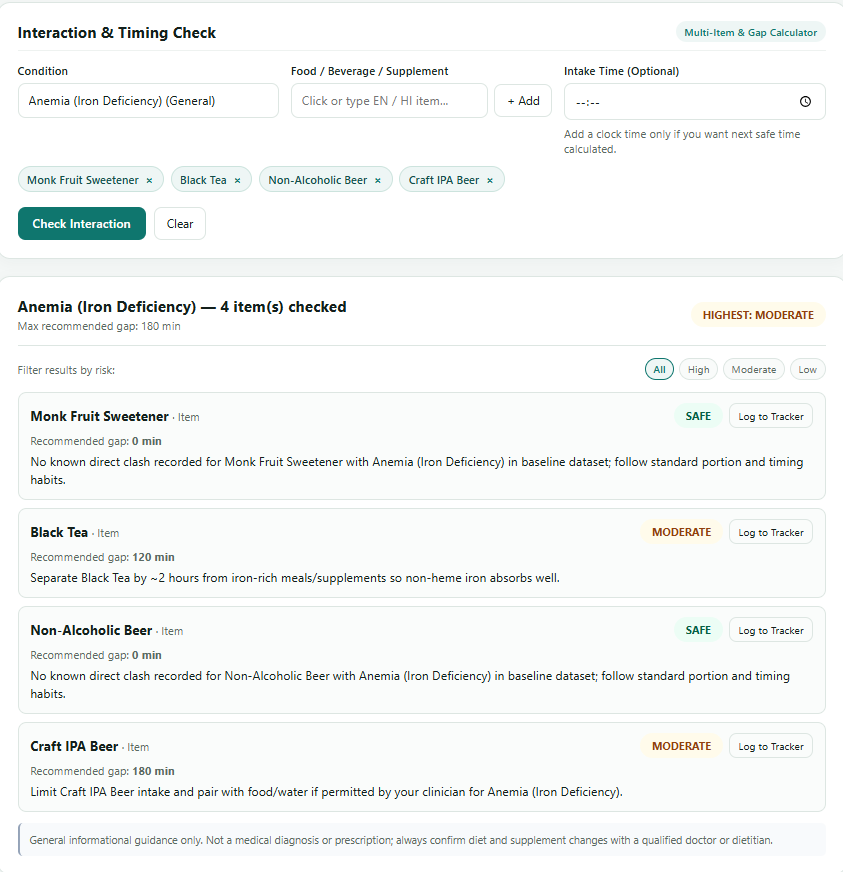
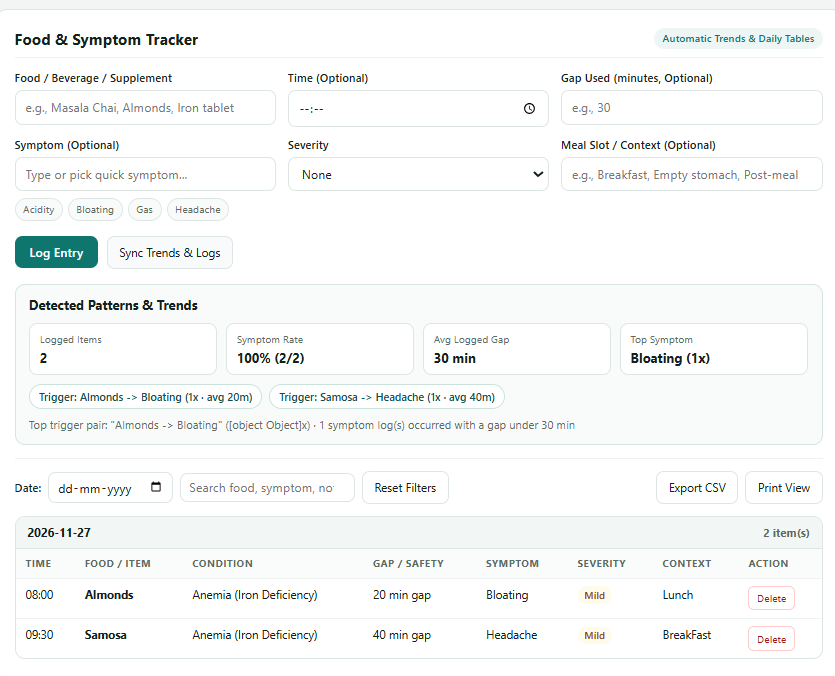

# SafeBite

SafeBite is a dietary interaction and daily food-and-symptom tracking application designed to help users evaluate potential food–condition conflicts, timing gaps, and recurring patterns between meals and symptoms.

## Problem Statement

People managing chronic conditions, food intolerances, or specific dietary goals often struggle to connect everyday meals, beverages, alcohol, and processed/junk foods with delayed symptoms or timing conflicts. Generic food lists rarely account for:
* Condition-specific triggers (such as caffeine/mineral spacing around thyroid care, glycemic load with blood-sugar/metabolic goals, alcohol/purine/sodium/fat sensitivity, or allergens and intolerances).
* Practical **waiting/gap windows** (`gap_minutes`) between items or meals.
* Structured daily logging (`diary_logs`) to observe patterns over time rather than relying on memory.

## What SafeBite Solves

* **Condition & Item Interaction Lookup:** Evaluates combinations of health conditions and food/drink/supplement items (`Safe`, `Low`, `Moderate`, `High`), providing a suggested `gap_minutes` window, actionable guidance (`advice`), and rule/data attribution (`source`).
* **Broad Dietary Coverage:** Includes everyday meals, beverages, alcohol, and junk/fried/sugary/processed items across large-scale interaction matrices (`150 × 1,000` = `150,000` rows in the baseline dataset and `250 × 1,100` = `275,000` rows in the expanded dataset).
* **Structured Symptom & Diet Tracking:** Uses relational database tables (`users`, `conditions`, `items`, `diary_logs`) so users can record meals, notes, and symptoms cleanly.

## How It Works & Interaction Logic

1. **Relational Data Model:**
   * `conditions` stores health conditions/profiles.
   * `items` stores foods, beverages, alcoholic drinks, processed/junk foods, and supplements.
   * `interactions` maps `(condition, item)` pairs to `risk_level`, `gap_minutes`, `advice`, and `source`.
   * `diary_logs` links user entries to `users`, `conditions`, and `items` with foreign-key constraints and a `gap_minutes` check (`0` to `1440` minutes).
2. **Rule-Based & Pattern Evaluation Logic:**
   * **Direct Allergen & Intolerance Rules:** Flags strict avoidance (`High` risk, `0` min gap) for major allergies/intolerances when matching ingredients or allergens are present (e.g., peanuts, tree nuts, dairy/lactose, gluten/celiac, eggs, shellfish, soy, sesame, wheat).
   * **Category & Physiological Trigger Rules:** Evaluates alcohol, caffeine, high-sugar/high-GI items, high-fat/fried items, high-sodium items, purine-rich foods, histamine-rich foods, fermentable/FODMAP items, and absorption-timing conflicts (such as spacing thyroid or iron-related items).
   * **Baseline / Tolerance Fallback:** When no direct clinical-rule conflict is triggered in the rule set, assigns baseline guidance (`Safe`, `Low`, or `Moderate` with optional spacing in minutes) for personal tolerance tracking.
3. **Data Source & Generation:**
   * The interaction datasets (`150 × 1,000` and `250 × 1,100`) were synthetically generated and structured using rule-based dietary/timing logic and standard nutrition reference categories for application testing and pattern exploration—not scraped from proprietary clinical databases or medical records.

## Screenshots

> Update `.png` to `.jpg` below if your files in `backend/assets/` are saved as `.jpg`.

### Symptoms & Interaction View

### Diet & Data Table View

## Deployment & Scaling Notes

* **Dataset Scale:**
  * Baseline (`150 × 1,000`): `150,000` rows (`Safe`: `102,295`, `Low`: `28,685`, `Moderate`: `17,061`, `High`: `1,959`).
  * Expanded (`interactions_250x1100.csv`, `250 × 1,100`): `275,000` rows (`Safe`: `187,352`, `Low`: `52,115`, `Moderate`: `32,683`, `High`: `2,850`).
* **Memory & Hosting Lesson (Render 512 MB Limit):** Large CSV files (`60+ MB` or `275k` rows) can exceed a `512 MB` RAM limit if loaded all at once during build or startup. Use chunked reading (`chunksize` / streaming) and batch inserts (`executemany` inside a single transaction, skipping if already seeded) to keep memory usage low.

## Disclaimer

SafeBite is an informational and tracking project built for educational and personal pattern-logging purposes. It does not provide medical diagnosis, treatment, or clinical advice. Always consult a qualified physician or registered dietitian regarding medical conditions, allergies, medications, or dietary changes.